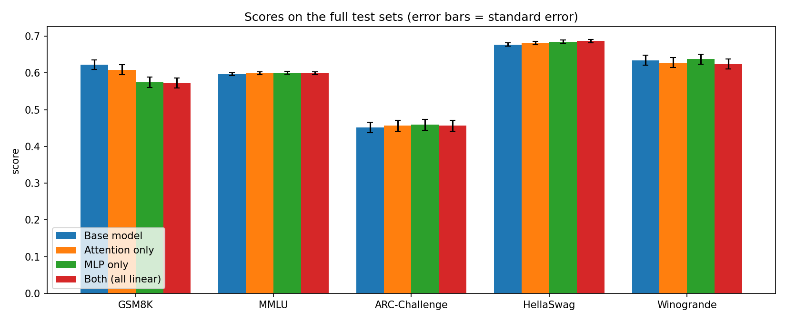
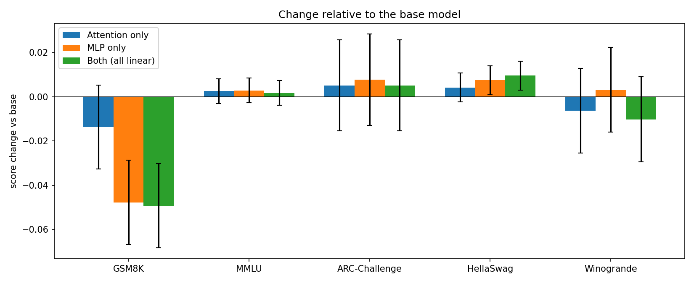
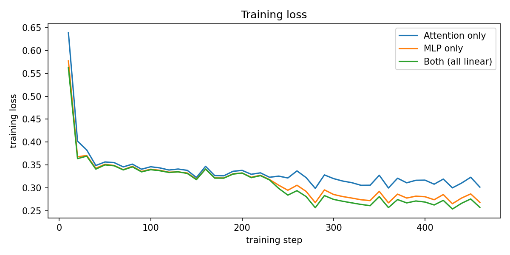
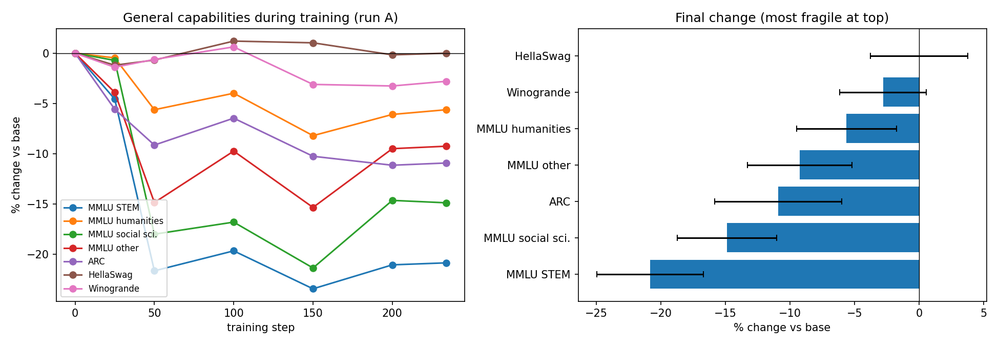
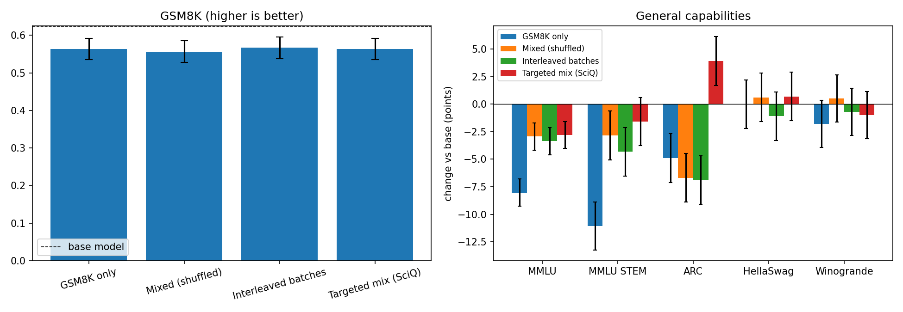
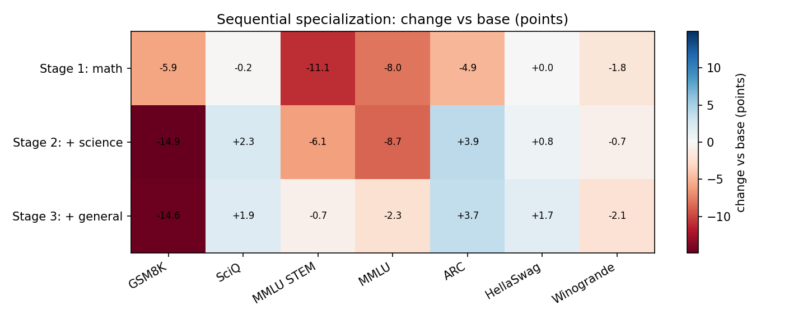
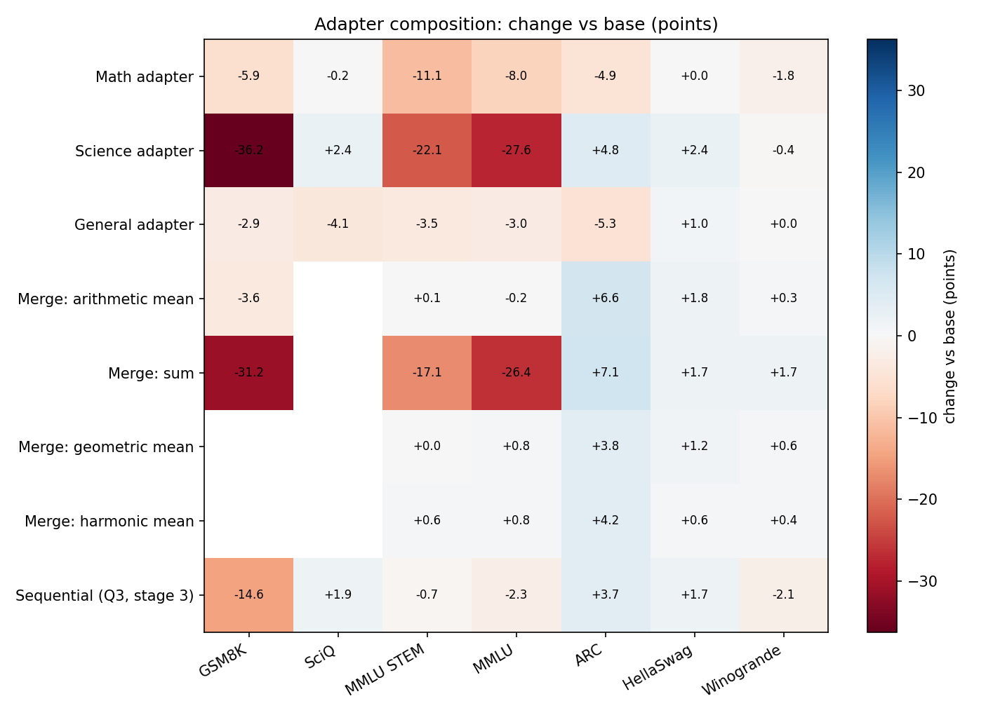
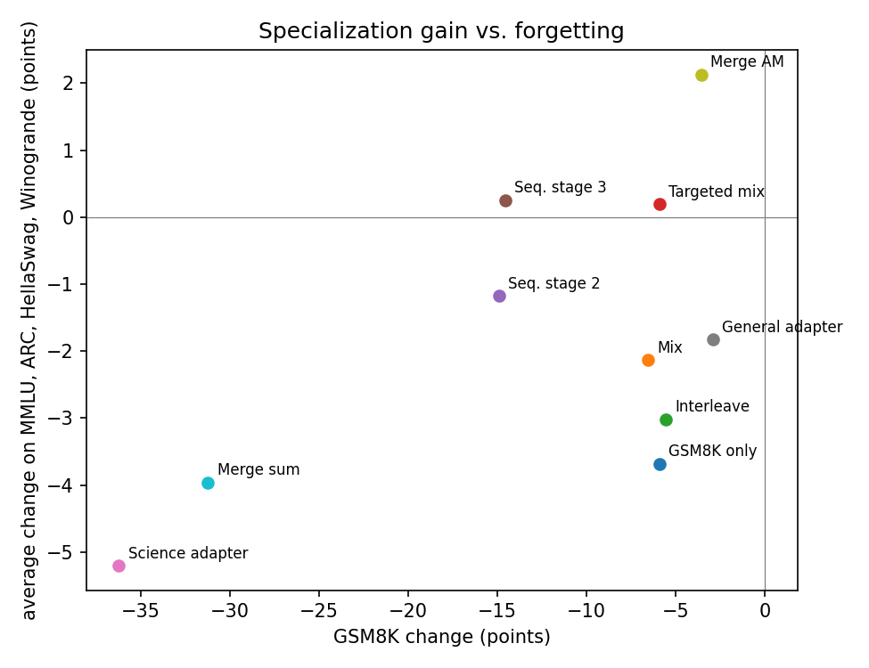

# Specialization Without Catastrophic Forgetting in Small Language Models

We fine-tune `Qwen/Qwen2.5-1.5B` with LoRA on GSM8K (math) and measure what is gained on math and what is lost elsewhere. We ask which capabilities are most fragile, whether data strategies reduce forgetting, whether a model can be specialized for several domains in sequence, and whether separately trained adapters can be merged.

## Benchmarks

| Benchmark | What it tests | Questions (full set) | Metric | Role |
|---|---|---:|---|---|
| GSM8K | Grade-school math word problems; the model writes a solution | 1,319 | exact match (flexible-extract) | Target skill |
| MMLU | Knowledge across 57 subjects (STEM, humanities, social sciences, other) | 14,042 | accuracy | General knowledge |
| ARC-Challenge | Hard science questions | 1,172 | acc_norm | Science reasoning |
| HellaSwag | Commonsense sentence completion | 10,042 | acc_norm | Commonsense |
| Winogrande | Pronoun resolution | 1,267 | accuracy | Language understanding |
| SciQ | Science question answering (multiple choice) | 1,000 | accuracy | Science domain / retention |

Chance level: 25% for MMLU, ARC and HellaSwag; 50% for Winogrande. All evaluations use [lm-evaluation-harness](https://github.com/EleutherAI/lm-evaluation-harness), base-model prompting without a chat template, `float16`, greedy decoding.

## Evaluation protocols

| Protocol | Used for | GSM8K | MMLU | ARC / HellaSwag / Winogrande | SciQ |
|---|---|---|---|---|---|
| Full test sets | reference adapters (section 1) | 5-shot, all 1,319 | 0-shot, all | 0-shot, all | - |
| Limited | all stress experiments (sections 2 to 5) | 5-shot, first 300 | 0-shot, 50 per subject | 0-shot, first 1,000 | 0-shot, all 1,000 |

GSM8K uses `max_gen_toks=256`. The base model's GSM8K in the limited protocol is its full-test score (0.622), which matches its first-300 score (0.623). Changes marked **\*** are larger than twice the combined standard error and unlikely to be noise.

## Training runs

| Run | Data (examples) | Schedule | Start from | LR | Epochs | Steps | Minutes | Trainable params |
|---|---|---|---|---:|---:|---:|---:|---:|
| A | gsm8k:all | shuffle | base model | 0.001 | 1 | 234 | 28 | 18.5M |
| Dg | alpaca:3200 | shuffle | base model | 0.001 | 1 | 100 | 14 | 18.5M |
| Ds | sciq:3200 | shuffle | base model | 0.001 | 1 | 100 | 6 | 18.5M |
| M1_mix | gsm8k:all,alpaca:3200 | shuffle | base model | 0.001 | 1 | 334 | 45 | 18.5M |
| M2_interleave | gsm8k:all,alpaca:3200 | interleave | base model | 0.001 | 1 | 333 | 45 | 18.5M |
| M3_targeted | gsm8k:all,sciq:3200 | shuffle | base model | 0.001 | 1 | 334 | 39 | 18.5M |
| S2 | gsm8k:1000,sciq:2400 | shuffle | A | 0.001 | 1 | 107 | 9 | 18.5M |
| S3 | gsm8k:700,sciq:700,alpaca:2000 | shuffle | S2 | 0.001 | 1 | 107 | 14 | 18.5M |
| attn_only | gsm8k:all | shuffle | base model | 0.0002 | 2 | 468 | - | 4.4M |
| both | gsm8k:all | shuffle | base model | 0.0002 | 2 | 468 | - | 18.5M |
| mlp_only | gsm8k:all | shuffle | base model | 0.0002 | 2 | 468 | - | 14.1M |

All runs: LoRA rank 16, alpha 32, dropout 0.05, all linear layers (`q,k,v,o,gate,up,down`) unless the name says otherwise, effective batch 32 (4 x 8 accumulation), cosine schedule with 15 warmup steps, fp16, seed 42, loss on answer tokens only, max 512 tokens. `attn_only`, `mlp_only` and `both` are the reference runs (lr 2e-4, 2 epochs); the other runs are the stress setting (lr 1e-3, a single pass).

## 1. Reference setting: where to put the adapters

Full test sets, lr 2e-4, 2 epochs on GSM8K. Values are score ± standard error.

| Model | GSM8K | MMLU | ARC-Challenge | HellaSwag | Winogrande |
|---|---:|---:|---:|---:|---:|
| Base model | 0.622 ± 0.013 | 0.597 ± 0.004 | 0.451 ± 0.015 | 0.677 ± 0.005 | 0.635 ± 0.014 |
| Attention only | 0.609 ± 0.013 | 0.600 ± 0.004 | 0.456 ± 0.015 | 0.682 ± 0.005 | 0.628 ± 0.014 |
| MLP only | 0.575 ± 0.014 | 0.600 ± 0.004 | 0.459 ± 0.015 | 0.685 ± 0.005 | 0.638 ± 0.014 |
| Both (all linear) | 0.573 ± 0.014 | 0.599 ± 0.004 | 0.456 ± 0.015 | 0.687 ± 0.005 | 0.624 ± 0.014 |

## 2. Which capabilities are most fragile?

Run `A`: GSM8K only, lr 1e-3, 234 steps, evaluated at several checkpoints. Change relative to the base model:

| Capability | Base | Final | Change (pts) | Relative |
|---|---:|---:|---:|---:|
| MMLU STEM | 0.531 | 0.420 | -11.1 * | -21% |
| MMLU social sci. | 0.695 | 0.592 | -10.3 * | -15% |
| ARC | 0.449 | 0.400 | -4.9 * | -11% |
| MMLU other | 0.632 | 0.574 | -5.8 * | -9% |
| MMLU humanities | 0.657 | 0.620 | -3.7 | -6% |
| Winogrande | 0.644 | 0.626 | -1.8 | -3% |
| SciQ | 0.942 | 0.940 | -0.2 | -0% |
| HellaSwag | 0.584 | 0.584 | +0.0 | +0% |

## 3. Data strategies

All runs use the same GSM8K examples and the stress setting. `Mixed` adds 3,200 Alpaca examples shuffled in; `Interleaved` alternates whole batches of GSM8K and Alpaca; `Targeted` adds 3,200 SciQ examples (aimed at the most fragile area, MMLU STEM).

| Model | GSM8K | MMLU | MMLU STEM | ARC | HellaSwag | Winogrande | SciQ |
|---|---:|---:|---:|---:|---:|---:|---:|
| GSM8K only | 0.563 ± 0.029 | 0.537 ± 0.009 | 0.420 ± 0.015 | 0.400 ± 0.015 | 0.584 ± 0.016 | 0.626 ± 0.015 | 0.940 ± 0.008 |
| Mixed (shuffled) | 0.557 ± 0.029 | 0.588 ± 0.009 | 0.502 ± 0.016 | 0.382 ± 0.015 | 0.590 ± 0.016 | 0.649 ± 0.015 | 0.908 ± 0.009 |
| Interleaved batches | 0.567 ± 0.029 | 0.584 ± 0.009 | 0.487 ± 0.016 | 0.380 ± 0.015 | 0.573 ± 0.016 | 0.637 ± 0.015 | 0.910 ± 0.009 |
| Targeted mix (SciQ) | 0.563 ± 0.029 | 0.589 ± 0.009 | 0.515 ± 0.015 | 0.488 ± 0.016 | 0.591 ± 0.016 | 0.634 ± 0.015 | 0.966 ± 0.006 |

Change vs base (points):

| Model | GSM8K | MMLU | MMLU STEM | ARC | HellaSwag | Winogrande | SciQ | Avg (4 general) |
|---|---:|---:|---:|---:|---:|---:|---:|---:|
| GSM8K only | -5.9 | -8.0 * | -11.1 * | -4.9 * | +0.0 | -1.8 | -0.2 | -3.7 |
| Mixed (shuffled) | -6.6 * | -2.9 * | -2.8 | -6.7 * | +0.6 | +0.5 | -3.4 * | -2.1 |
| Interleaved batches | -5.6 | -3.4 * | -4.3 | -6.9 * | -1.1 | -0.7 | -3.2 * | -3.0 |
| Targeted mix (SciQ) | -5.9 | -2.8 * | -1.6 | +3.9 | +0.7 | -1.0 | +2.4 * | +0.2 |

- **GSM8K only:** GSM8K -5.9, MMLU STEM -11.1 *, MMLU -8.0 *, SciQ -0.2; average general change -3.7
- **Mixed (shuffled):** GSM8K -6.6 *, MMLU STEM -2.8, MMLU -2.9 *, SciQ -3.4 *; average general change -2.1
- **Interleaved batches:** GSM8K -5.6, MMLU STEM -4.3, MMLU -3.4 *, SciQ -3.2 *; average general change -3.0
- **Targeted mix (SciQ):** GSM8K -5.9, MMLU STEM -1.6, MMLU -2.8 *, SciQ +2.4 *; average general change +0.2

## 4. Sequential specialization

Stage 1 is run `A` (math). Stage 2 continues from it on 1,000 GSM8K examples (replay) plus 2,400 SciQ. Stage 3 continues on 700 GSM8K, 700 SciQ and 2,000 Alpaca.

| Model | GSM8K | MMLU | MMLU STEM | ARC | HellaSwag | Winogrande | SciQ | Avg (4 general) |
|---|---:|---:|---:|---:|---:|---:|---:|---:|
| Stage 1: math | -5.9 | -8.0 * | -11.1 * | -4.9 * | +0.0 | -1.8 | -0.2 | -3.7 |
| Stage 2: + science | -14.9 * | -8.7 * | -6.1 * | +3.9 | +0.8 | -0.7 | +2.3 * | -1.2 |
| Stage 3: + general | -14.6 * | -2.3 | -0.7 | +3.7 | +1.7 | -2.1 | +1.9 | +0.3 |

- **Stage 1: math:** GSM8K -5.9, MMLU STEM -11.1 *, MMLU -8.0 *, SciQ -0.2; average general change -3.7
- **Stage 2: + science:** GSM8K -14.9 *, MMLU STEM -6.1 *, MMLU -8.7 *, SciQ +2.3 *; average general change -1.2
- **Stage 3: + general:** GSM8K -14.6 *, MMLU STEM -0.7, MMLU -2.3, SciQ +1.9; average general change +0.3

## 5. Adapter composition

Math (`A`), science (`Ds`, 3,200 SciQ) and general (`Dg`, 3,200 Alpaca) adapters were trained separately from the base model with the stress setting, then merged in weight-change space (the full update B·A of each adapter). Methods: arithmetic mean, sum (task arithmetic, scale 1), and geometric and harmonic means that keep an entry only where all adapters agree on its sign (a plain geometric mean is undefined for signed values).

| Model | GSM8K | MMLU | MMLU STEM | ARC | HellaSwag | Winogrande | SciQ |
|---|---:|---:|---:|---:|---:|---:|---:|
| Math adapter | 0.563 ± 0.029 | 0.537 ± 0.009 | 0.420 ± 0.015 | 0.400 ± 0.015 | 0.584 ± 0.016 | 0.626 ± 0.015 | 0.940 ± 0.008 |
| Science adapter | 0.260 ± 0.025 | 0.341 ± 0.009 | 0.309 ± 0.015 | 0.497 ± 0.016 | 0.608 ± 0.015 | 0.640 ± 0.015 | 0.966 ± 0.006 |
| General adapter | 0.593 ± 0.028 | 0.587 ± 0.009 | 0.496 ± 0.016 | 0.396 ± 0.015 | 0.594 ± 0.016 | 0.644 ± 0.015 | 0.901 ± 0.009 |
| Merge: arithmetic mean | 0.587 ± 0.028 | 0.615 ± 0.009 | 0.532 ± 0.016 | 0.515 ± 0.016 | 0.602 ± 0.015 | 0.647 ± 0.015 | - |
| Merge: sum | 0.310 ± 0.027 | 0.354 ± 0.009 | 0.360 ± 0.015 | 0.520 ± 0.016 | 0.601 ± 0.015 | 0.661 ± 0.015 | - |
| Merge: geometric mean | - | 0.626 ± 0.009 | 0.531 ± 0.016 | 0.487 ± 0.016 | 0.596 ± 0.016 | 0.650 ± 0.015 | - |
| Merge: harmonic mean | - | 0.625 ± 0.009 | 0.537 ± 0.016 | 0.491 ± 0.016 | 0.590 ± 0.016 | 0.648 ± 0.015 | - |
| Sequential (Q3, stage 3) | 0.477 ± 0.029 | 0.594 ± 0.009 | 0.523 ± 0.016 | 0.486 ± 0.016 | 0.601 ± 0.015 | 0.623 ± 0.015 | 0.961 ± 0.006 |

Change vs base (points):

| Model | GSM8K | MMLU | MMLU STEM | ARC | HellaSwag | Winogrande | SciQ | Avg (4 general) |
|---|---:|---:|---:|---:|---:|---:|---:|---:|
| Math adapter | -5.9 | -8.0 * | -11.1 * | -4.9 * | +0.0 | -1.8 | -0.2 | -3.7 |
| Science adapter | -36.2 * | -27.6 * | -22.1 * | +4.8 * | +2.4 | -0.4 | +2.4 * | -5.2 |
| General adapter | -2.9 | -3.0 * | -3.5 | -5.3 * | +1.0 | +0.0 | -4.1 * | -1.8 |
| Merge: arithmetic mean | -3.6 | -0.2 | +0.1 | +6.6 * | +1.8 | +0.3 | - | +2.1 |
| Merge: sum | -31.2 * | -26.4 * | -17.1 * | +7.1 * | +1.7 | +1.7 | - | -4.0 |
| Merge: geometric mean | - | +0.8 | +0.0 | +3.8 | +1.2 | +0.6 | - | +1.6 |
| Merge: harmonic mean | - | +0.8 | +0.6 | +4.2 | +0.6 | +0.4 | - | +1.5 |
| Sequential (Q3, stage 3) | -14.6 * | -2.3 | -0.7 | +3.7 | +1.7 | -2.1 | +1.9 | +0.3 |

- **Math adapter:** GSM8K -5.9, MMLU STEM -11.1 *, MMLU -8.0 *, SciQ -0.2; average general change -3.7
- **Science adapter:** GSM8K -36.2 *, MMLU STEM -22.1 *, MMLU -27.6 *, SciQ +2.4 *; average general change -5.2
- **General adapter:** GSM8K -2.9, MMLU STEM -3.5, MMLU -3.0 *, SciQ -4.1 *; average general change -1.8
- **Merge: arithmetic mean:** GSM8K -3.6, MMLU STEM +0.1, MMLU -0.2; average general change +2.1
- **Merge: sum:** GSM8K -31.2 *, MMLU STEM -17.1 *, MMLU -26.4 *; average general change -4.0
- **Merge: geometric mean:** MMLU STEM +0.0, MMLU +0.8; average general change +1.6
- **Merge: harmonic mean:** MMLU STEM +0.6, MMLU +0.8; average general change +1.5
- **Sequential (Q3, stage 3):** GSM8K -14.6 *, MMLU STEM -0.7, MMLU -2.3, SciQ +1.9; average general change +0.3

## Gain versus forgetting

## Key observations

*To be written from the results above.*

## Limitations

- Single seed per configuration; differences smaller than about two standard errors should be treated as noise.
- Limited evaluations in sections 2 to 5 (first 300 GSM8K questions, 1,000 questions for ARC, HellaSwag and Winogrande, 50 per MMLU subject).
- The stress setting (lr 1e-3, one pass) was chosen because the reference setting (lr 2e-4) produced no measurable forgetting; it also leaves GSM8K at or below the base model, so these runs measure forgetting more than specialization gain.
- SciQ is almost saturated for this model (about 0.94), so it measures retention rather than learning.
- Geometric and harmonic merges use a sign-agreement rule of our own design, not a published method.

## Reproducing

`train_v2.py` trains (data mix, schedule and starting adapter are flags), `ev.py` runs the evaluation suites, `merge.py` merges adapters, `run_all.py` runs the whole pipeline and resumes after interruptions, `collect.py` builds `results/summary.csv`, and `make_report2.py` regenerates the figures and this README. Fine-tuned adapters (fp16) are in `adapters_backup/`.
