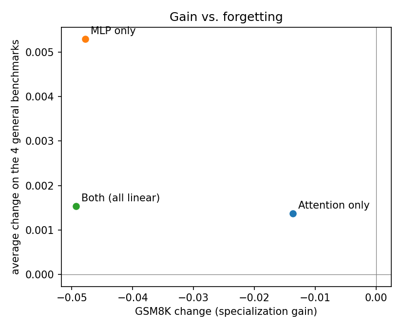

# Specialization Without Catastrophic Forgetting in Small Language Models

We fine-tune `Qwen/Qwen2.5-1.5B` on GSM8K (math) with LoRA, once with adapters on the attention layers only, once on the MLP layers only, and once on both, then measure what each configuration gains on math and what it loses on general benchmarks (full test sets, no sample limits).

## Benchmarks

| Benchmark | What it tests | Questions | Metric | Role |
|---|---|---:|---|---|
| GSM8K | Grade-school math word problems; model writes a solution | 1,319 | exact match (flexible-extract) | Target skill |
| MMLU | Knowledge across 57 subjects | 14,042 | accuracy | General knowledge |
| ARC-Challenge | Hard science questions | 1,172 | acc_norm | Science reasoning |
| HellaSwag | Commonsense sentence completion | 10,042 | acc_norm | Commonsense |
| Winogrande | Pronoun resolution | 1,267 | accuracy | Language understanding |

Chance level: 25% for MMLU, ARC and HellaSwag; 50% for Winogrande.

## Evaluation settings

[lm-evaluation-harness](https://github.com/EleutherAI/lm-evaluation-harness), base-model prompting (no chat template), `float16`, greedy decoding. GSM8K: 5-shot, `max_gen_toks=256`. All other benchmarks: 0-shot. No `--limit` anywhere.

## Training setup

Data: GSM8K train split, all 7,473 examples. Prompt `Question: ...\nAnswer:`, loss on answer tokens only, max 512 tokens.

| Setting | Value |
|---|---|
| LoRA rank / alpha / dropout | 16 / 32 / 0.05 |
| Learning rate | 0.0002 (cosine, 15 warmup steps) |
| Epochs | 2 |
| Batch size | 4 x 8 accumulation = 32 |
| Precision | fp16 |
| Checkpoints | every 50 steps |
| Seed | 42 |

| Configuration | Target modules | Trainable parameters |
|---|---|---:|
| Attention only | q_proj, k_proj, v_proj, o_proj | 4.4M |
| MLP only | gate_proj, up_proj, down_proj | 14.1M |
| Both (all linear) | q_proj, k_proj, v_proj, o_proj, gate_proj, up_proj, down_proj | 18.5M |

## Results

| Model | GSM8K | MMLU | ARC-Challenge | HellaSwag | Winogrande |
|---|---:|---:|---:|---:|---:|
| Base model | 0.622 ± 0.013 | 0.597 ± 0.004 | 0.451 ± 0.015 | 0.677 ± 0.005 | 0.635 ± 0.014 |
| Attention only | 0.609 ± 0.013 | 0.600 ± 0.004 | 0.456 ± 0.015 | 0.682 ± 0.005 | 0.628 ± 0.014 |
| MLP only | 0.575 ± 0.014 | 0.600 ± 0.004 | 0.459 ± 0.015 | 0.685 ± 0.005 | 0.638 ± 0.014 |
| Both (all linear) | 0.573 ± 0.014 | 0.599 ± 0.004 | 0.456 ± 0.015 | 0.687 ± 0.005 | 0.624 ± 0.014 |

Values are score ± standard error.

### Change relative to the base model

| Model | GSM8K | MMLU | ARC-Challenge | HellaSwag | Winogrande | Avg (4 general) |
|---|---:|---:|---:|---:|---:|---:|
| Attention only | -0.014 | +0.002 | +0.005 | +0.004 | -0.006 | +0.001 |
| MLP only | -0.048 * | +0.003 | +0.008 | +0.007 | +0.003 | +0.005 |
| Both (all linear) | -0.049 * | +0.002 | +0.005 | +0.010 | -0.010 | +0.002 |

\* larger than twice the combined standard error (unpaired), so unlikely to be noise.

### Gain vs. forgetting

## Key observations

Changes beyond noise: MLP only: GSM8K -0.048; Both (all linear): GSM8K -0.049

*Add your interpretation here.*

## Reproducing

1. `python train.py --name attn_only --modules attn` (likewise `mlp_only --modules mlp`, `both --modules all`)
2. Evaluate with `lm_eval` using the settings above, writing to `results/<model>_<kind>_full/`
3. `python make_report.py` regenerates the figures and this README.
